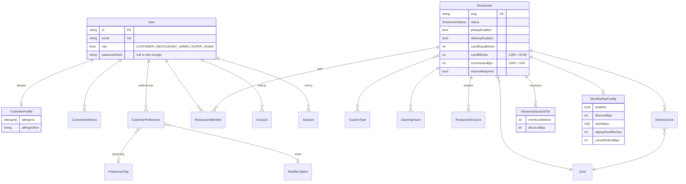
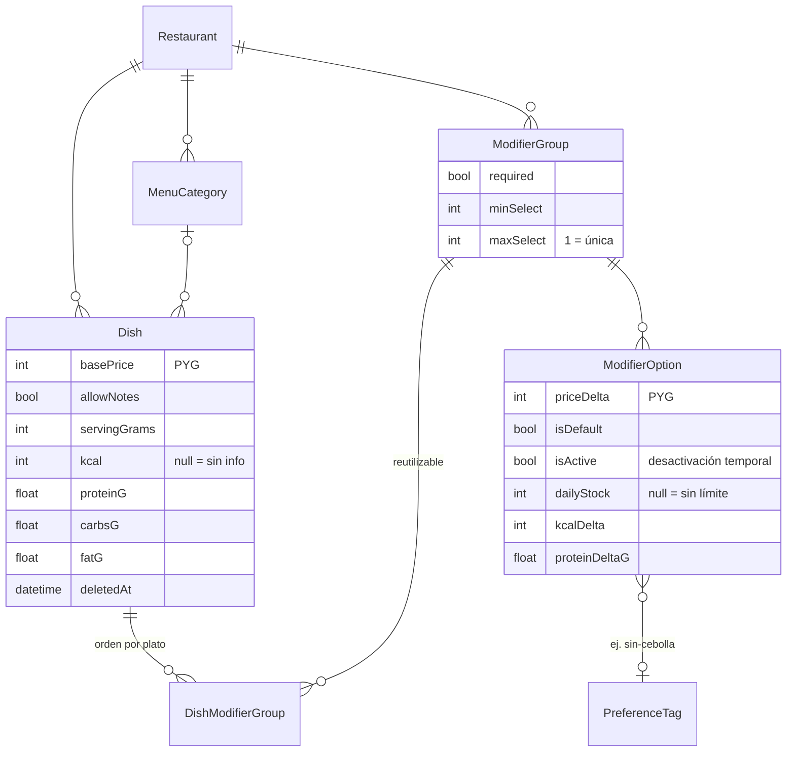
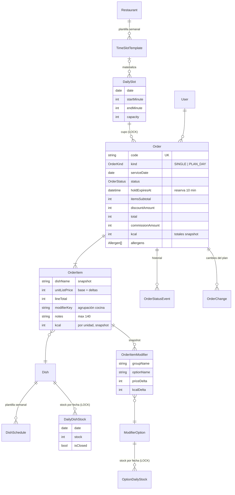
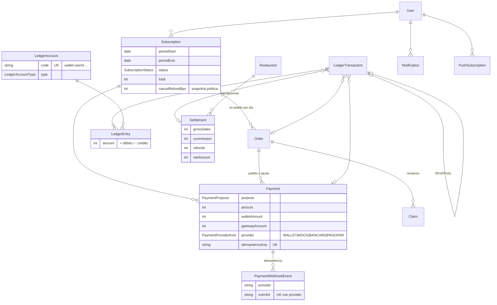

# Fase 1 — Modelo de datos

Fuente de verdad: [`prisma/schema.prisma`](../prisma/schema.prisma).
Migraciones: [`prisma/migrations/`](../prisma/migrations/). La primera crea las tablas; la segunda agrega las reglas que Prisma no puede expresar (CHECKs y triggers del ledger).

## Resumen en simple

- **Restaurante:** define su menú (platos con macros), sus modificadores (punto de cocción, extras…), qué platos vende cada día y cuántos, sus franjas horarias con cupo, la hora de corte, los descuentos y el plan mensual.
- **Cliente:** arma un **pedido** para un día y una franja. Cada pedido guarda una **foto** (snapshot) de lo que compró: nombres, precios y macros de ese momento. Si el restaurante cambia el menú después, el pedido no se modifica.
- **Plan mensual:** es una **suscripción** que genera **un pedido por cada día elegido**. Así la cocina ve los días del plan igual que cualquier otro pedido.
- **Dinero:** todo movimiento (pagos, reembolsos a la billetera, comisiones, liquidaciones) se anota en un **libro contable (ledger)** de doble registro. La base de datos **prohíbe** editarlo o borrarlo y **rechaza** cualquier transacción cuyos débitos y créditos no sumen cero.
- **Sobreventa imposible:** cada plato por día y cada franja por día tienen una fila que se **bloquea** mientras se reserva. Lo vendido se cuenta desde los pedidos, no desde un contador que se pueda desincronizar.

---

## Diagrama de entidades

El modelo tiene unas 40 tablas, así que va dividido en 4 diagramas por dominio. Solo se muestran los campos clave.

### 1. Usuarios, restaurantes y configuración



### 2. Menú, macros y modificadores



### 3. Disponibilidad y pedidos



### 4. Plan mensual, pagos, ledger y post-venta



---

## Decisiones y por qué

### Convenciones de tipos

| Qué | Cómo se guarda | Por qué |
|---|---|---|
| Dinero | `Int` en guaraníes | El PYG no tiene decimales. Con enteros no hay errores de redondeo de punto flotante. |
| Porcentajes | `Int` en *basis points* (`1000` = 10%) | Permite 12,5% (`1250`) sin decimales. |
| Día del pedido | `DATE` | Un pedido es "para el martes 4". Guardarlo como instante UTC haría que el día cambie según la zona horaria. Se interpreta en America/Asuncion. |
| Hora del día (franjas, corte) | `Int` minutos desde 00:00 | `720` = 12:00. Comparar y sumar es trivial y no depende de la zona horaria. |
| Instantes (reserva, pago) | `timestamptz` | Instantes reales; la app los muestra en America/Asuncion. |
| Gramos de macros | `Float` | Son valores aproximados informados por el restaurante. Se redondean a 1 decimal al calcular. |

### Snapshots (los pedidos no dependen del menú vivo)

`OrderItem` guarda el nombre del plato, el precio base, el total de modificadores, el precio de lista, el descuento asignado a la línea y los **macros por unidad**. `OrderItemModifier` guarda el nombre del grupo y de la opción, el `priceDelta` y los deltas de macros **de ese momento**. Si el restaurante renombra o borra una opción, los pedidos hechos no cambian.

Por eso además platos, grupos y opciones **no se borran físicamente**: tienen `deletedAt` (soft delete). Así las claves foráneas de pedidos viejos siguen siendo válidas.

### Agrupación para la cocina: `modifierKey`

Al crear el ítem se calcula `modifierKey`: los ids de las opciones elegidas, **ordenados** y unidos (`""` si no tiene modificadores). La lista de producción agrupa por `(dishId, modifierKey)`. Así "A punto + Sin cebolla" y "Sin cebolla + A punto" caen en el mismo grupo. El texto legible (`modifierSummary`, ej. "A punto · Sin cebolla") sale del snapshot. Hay un índice en `(dishId, modifierKey)`.

### Stock y cupo sin sobreventa (y sin depender de crons)

Hay dos alternativas típicas:

1. Contadores (`vendidos`, `reservados`) que se suman y se restan.
2. **Bloquear una fila y contar desde los pedidos**: la que elegimos.

Cómo funciona: `DailyDishStock`, `OptionDailyStock` y `DailySlot` son filas por fecha. Al reservar, dentro de una transacción:

```sql
SELECT ... FROM "DailySlot" WHERE id = $1 FOR UPDATE;   -- serializa a quienes compiten por esa franja
SELECT count(*) FROM "Order"
 WHERE "slotId" = $1
   AND (status IN ('CONFIRMED','IN_PREPARATION','READY','DELIVERED')
        OR (status = 'PENDING_PAYMENT' AND "holdExpiresAt" > now()));
-- si count < capacity → crear el pedido PENDING_PAYMENT con holdExpiresAt = now() + 10 min
```

Por qué es mejor acá:

- **No hay contadores que se desincronicen.** La verdad está en los pedidos.
- **La reserva de 10 minutos vence sola.** Un pedido `PENDING_PAYMENT` vencido deja de contar en el `count` en el instante en que vence, sin depender de que un job lo libere. Esto importa en **Vercel**: en el plan Hobby los crons corren como mucho una vez por día. Un cron solo hace limpieza (pasa esos pedidos a `EXPIRED`), pero la corrección no depende de él.
- Las filas por fecha se **materializan** desde las plantillas semanales (`DishSchedule`, `TimeSlotTemplate`) con `INSERT … ON CONFLICT DO NOTHING` justo antes del bloqueo. El restaurante también puede editarlas a mano para un día puntual (subir el stock, cerrar una franja).
- Los bloqueos se toman siempre **en orden** (franja → platos por id → opciones por id) para evitar deadlocks entre transacciones.

El cupo de franja cuenta **pedidos**, no platos.

### Personalización

- `ModifierGroup` (con `required`, `minSelect`, `maxSelect`) y `ModifierOption` (con `priceDelta`, `isDefault`, `isActive`, `dailyStock` y deltas de macros) pertenecen al restaurante.
- `DishModifierGroup` es la relación muchos a muchos, con `sortOrder` **por plato**.
- La base de datos garantiza `minSelect ≤ maxSelect` y que un grupo `required` tenga `minSelect ≥ 1`. El resto de la validación (opciones activas, que pertenezcan al plato, cantidades) va en Zod en el servidor (Fase 4).
- **Alergias**: enum `Allergen` + `allergyOther` (texto corto). Están en `CustomerProfile` y se copian al `Order` al crearlo, donde se pueden editar.
- **Notas**: `OrderItem.notes VARCHAR(140)`, solo si `Dish.allowNotes`.

### Preferencias guardadas: cómo funcionan entre restaurantes

Problema: "sin cebolla" en el restaurante A es una opción distinta (otro id) que en el B. Solución:

- La plataforma tiene un catálogo `PreferenceTag` (`sin-cebolla`, `bien-cocido`, `tostadito`…). Cada restaurante puede **etiquetar** sus opciones con un tag.
- `CustomerPreference` tiene dos alcances:
  - `GENERAL` → `tagId`. Se precarga en **cualquier** plato que tenga una opción con ese tag.
  - `DISH` → `dishId + optionId`. Se precarga esa opción exacta en ese plato. Tiene prioridad sobre las generales.
- Si no aplica (el plato no tiene esa opción, o está inactiva, o excede `maxSelect`), se ignora sin error.

### Macros

- `Dish`: `servingGrams`, `kcal`, `proteinG`, `carbsG`, `fatG` y, opcionales, `fiberG`, `sugarG`, `sodiumMg`. `kcal = null` significa "Sin info nutricional".
- `ModifierOption`: deltas con default 0. Pueden ser negativos ("Sin papas: −250 kcal").
- Macros del ítem = plato + Σ deltas, **mínimo 0 por campo**. Se guardan en el snapshot del ítem (por unidad) y como totales en el `Order` (`nutritionComplete` indica si todos los ítems tenían macros).
- `Restaurant.macrosRequired` (lo controla el super admin) exige macros para publicar.
- `PlatformSettings.macroTolerancePct` (15% por defecto) define la tolerancia del aviso de coherencia kcal ≈ P×4 + C×4 + G×9. Es un aviso: no bloquea.
- La base de datos garantiza valores ≥ 0 en plato e ítem.

### Precio (siempre calculado en el servidor)

```
unitListPrice  = basePrice + Σ priceDelta
lineListTotal  = unitListPrice × quantity
itemsSubtotal  = Σ lineListTotal
discountAmount = round(itemsSubtotal × discountBps / 10000)    -- anticipación O plan, no se acumulan
total          = itemsSubtotal − discountAmount + deliveryFee
```

Estas igualdades además son **CHECK constraints** en la base de datos (`Order_amounts_chk`, `OrderItem_amounts_chk`). Un bug que calcule mal un total no puede persistirse. El descuento del pedido se reparte entre las líneas (`lineDiscount`) para que las liquidaciones y los reembolsos parciales cuadren al guaraní.

### Plan mensual = suscripción + un pedido por día

- `Subscription` guarda el período, los totales y una **copia de la política de cancelación** vigente al suscribirse. Si el restaurante la cambia después, no afecta a quien ya pagó.
- Cada día elegido es un `Order` con `kind = PLAN_DAY` y `subscriptionId`. La base de datos garantiza la coherencia (`Order_kind_chk`). La lista de producción no necesita saber de planes.
- El total de cada día es su parte del pago del plan. Por eso cancelar un día reembolsa exactamente ese monto × `cancelRefundBps`.
- **Cambio de plato o modificadores de un día**: se reemplazan los ítems del pedido (antes de la hora de corte) y queda registro en `OrderChange` (ítems anteriores y nuevos, diferencia, y si se cobró con un `Payment` de tipo `ORDER_ADJUSTMENT` o se acreditó en la billetera).
- Los totales nutricionales del plan se calculan sumando los pedidos del plan.

### Pagos

- `Payment` puede cubrir un pedido, un plan o un ajuste. La base de datos lo verifica (`Payment_target_chk`).
- `amount = walletAmount + gatewayAmount`: se puede pagar **parte con billetera** y parte con la pasarela. Si `provider = WALLET`, todo sale de la billetera.
- `idempotencyKey` único evita cobrar dos veces el mismo checkout (doble click o reintento).
- `PaymentWebhookEvent` tiene `UNIQUE(provider, eventId)`: un webhook repetido choca contra la restricción y no se procesa dos veces.
- `PaymentProviderKind` ya incluye `BANCARD` y `PAGOPAR` para la integración futura.

### Ledger inmutable de doble registro

Cuentas (`LedgerAccount.type`):

| Cuenta | Naturaleza | Una por |
|---|---|---|
| `CUSTOMER_WALLET` | pasivo (le debemos al cliente) | cliente |
| `RESTAURANT_PAYABLE` | pasivo (le debemos al restaurante) | restaurante |
| `PLATFORM_COMMISSION` | ingreso | plataforma |
| `GATEWAY_CLEARING` | activo (lo cobró la pasarela, falta que deposite) | plataforma |
| `PLATFORM_BANK` | activo | plataforma |
| `PLATFORM_PENALTY` | ingreso (penalidades por cancelación del restaurante) | plataforma |
| `PLATFORM_GOODWILL` | gasto (reembolsos que absorbe la plataforma) | plataforma |

Convención: `amount > 0` débito, `amount < 0` crédito. **Saldo de billetera = −Σ amount** de su cuenta.

Ejemplos (pedido de 50.000 Gs con comisión del 10%, 30.000 Gs con tarjeta y 20.000 Gs con billetera):

| Evento | Asientos |
|---|---|
| Pago aprobado | `GATEWAY_CLEARING +30.000` · `CUSTOMER_WALLET +20.000` · `RESTAURANT_PAYABLE −45.000` · `PLATFORM_COMMISSION −5.000` |
| El restaurante cancela (política por defecto: se devuelve la comisión, sin penalidad) | `RESTAURANT_PAYABLE +45.000` · `PLATFORM_COMMISSION +5.000` · `CUSTOMER_WALLET −50.000` |
| El restaurante cancela (acuerdo: absorbe la comisión + 5% de penalidad) | `RESTAURANT_PAYABLE +52.500` · `CUSTOMER_WALLET −50.000` · `PLATFORM_PENALTY −2.500` |
| Liquidación pagada | `RESTAURANT_PAYABLE +X` · `PLATFORM_BANK −X` |

Garantías en la base de datos (migración `integrity_and_ledger`, probadas en local):

- **Triggers que bloquean `UPDATE`, `DELETE` y `TRUNCATE`** en `LedgerEntry` y `LedgerTransaction`. Las correcciones son transacciones `REVERSAL` (con `reversalOfId` único: no se puede revertir dos veces).
- **Constraint trigger diferido** que al hacer `COMMIT` exige que cada transacción tenga al menos 2 asientos y sume exactamente 0.
- `idempotencyKey` único por transacción contable (ej. `payment:<id>:captured`) para que reprocesar un webhook no duplique el efecto.
- Para gastar billetera sin quedar en negativo se bloquea la fila de `LedgerAccount` (`FOR UPDATE`) antes de sumar el saldo (Fase 6).

### Pensado para Vercel + Neon

| Tema | Decisión |
|---|---|
| Conexiones | Prisma 7 con driver adapter `@prisma/adapter-pg` (sin binario de query engine, ideal para serverless). `DATABASE_URL` = URL **pooled** de Neon (`-pooler`); pool chico por instancia (`DATABASE_POOL_MAX=5`). |
| Migraciones | `prisma.config.ts` usa `DIRECT_URL` (sin pooler), porque `migrate` necesita advisory locks que PgBouncer no soporta. Script `vercel-build`: `prisma generate && prisma migrate deploy && next build`. |
| Transacciones con `FOR UPDATE` | Funcionan sobre el pooler de Neon (modo transacción: toda la transacción usa la misma conexión del servidor). |
| Crons | La corrección no depende de crons (reservas que vencen solas, webhooks idempotentes). Vercel Cron se usa para limpieza, recordatorios del día anterior y cierre por hora de corte; todas las tareas son idempotentes (`Notification.dedupeKey` único). |
| Fotos de platos | Vercel Blob (Fase 3). |
| Previews | Opcional: la integración Neon ↔ Vercel crea una rama de base de datos por cada preview deployment. |
| Local | `docker-compose.yml` con Postgres 16; ambas URLs apuntan a la misma base. |

### Otras decisiones

- **Roles**: `User.role` para el rol global y `RestaurantMember` (OWNER/MANAGER/STAFF) para saber a qué restaurante(s) administra cada usuario. Un admin podría gestionar varios locales.
- **Códigos legibles** (`Order.code`, `Subscription.code`) para la cocina y para atención al cliente, distintos del id interno.
- **`OrderStatusEvent`**: historial de cambios de estado con quién y por qué (el motivo obligatorio de una cancelación del restaurante queda acá y en `Order.cancelReason`).
- **`AuditLog`**: acciones sensibles del super admin (cambio de comisión, suspensión).
- **`PlatformSettings`**: fila única con la duración de la reserva (10 min), la comisión por defecto y la tolerancia de macros.

---

## Supuestos (confirmados)

1. **Cancelación por el restaurante**: el cliente **siempre** recibe el 100% en la billetera. Quién absorbe el costo depende de cada negocio y lo configura el **super admin** por restaurante (es parte del acuerdo comercial, como la comisión):
   - `restaurantCancelRefundsCommission` (por defecto `true`): la plataforma devuelve su comisión. Con `false`, la comisión la absorbe el restaurante.
   - `restaurantCancelPenaltyBps` (por defecto `0`): penalidad adicional, como % del total del pedido, que se descuenta en la liquidación.
   - Se aplica la política vigente **al momento de la cancelación**. Si el saldo `RESTAURANT_PAYABLE` queda negativo, se compensa en la próxima liquidación.
2. **Cancelación de un pedido suelto por el cliente** (la especificación no lo define): se permite hasta la hora de corte, con reembolso a la billetera del `customerCancelRefundBps` del restaurante (100% por defecto).
3. **Los descuentos no se acumulan**: un día del plan mensual lleva solo el descuento del plan, no el de anticipación.
4. **Anticipación**: se mide desde la creación del pedido hasta el **inicio de la franja**.
5. **Delivery**: el costo de envío no tiene descuento ni comisión y va íntegro al restaurante.
6. **Billetera**: se puede usar como pago total o parcial en cualquier restaurante. **No se puede retirar** a efectivo.
7. **Alergias**: a nivel pedido (no por ítem).
8. **Plan mensual**: el cliente elige una franja y una modalidad por defecto para todo el plan y puede cambiarlas por día. Los días disponibles son los `weekdays` del plan menos los feriados del restaurante.
9. **Liquidaciones**: incluyen los pedidos cuyo día de servicio cae en el período y no fueron cancelados, menos comisión y menos reembolsos.
